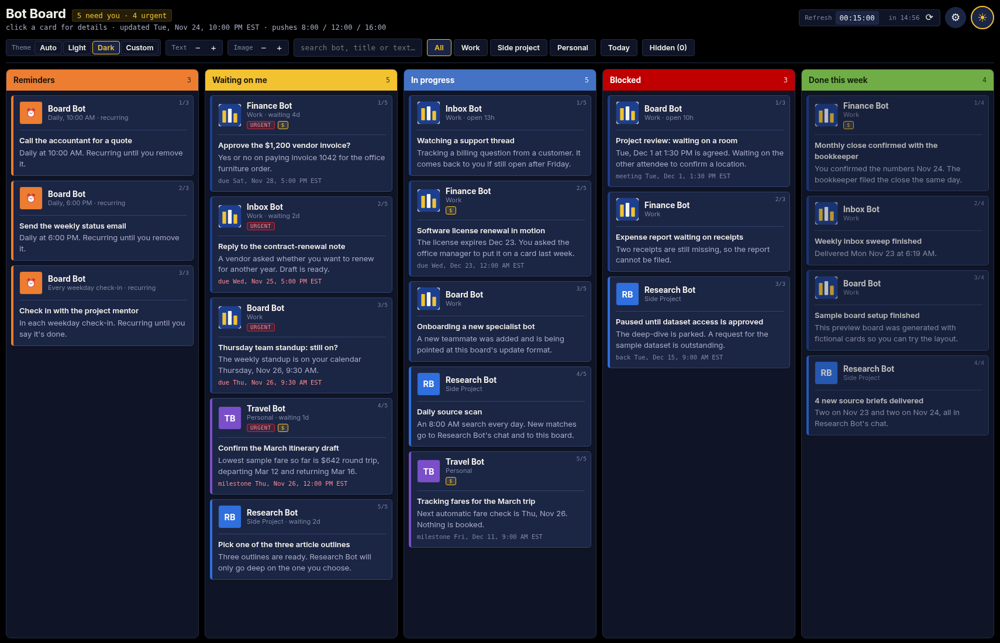
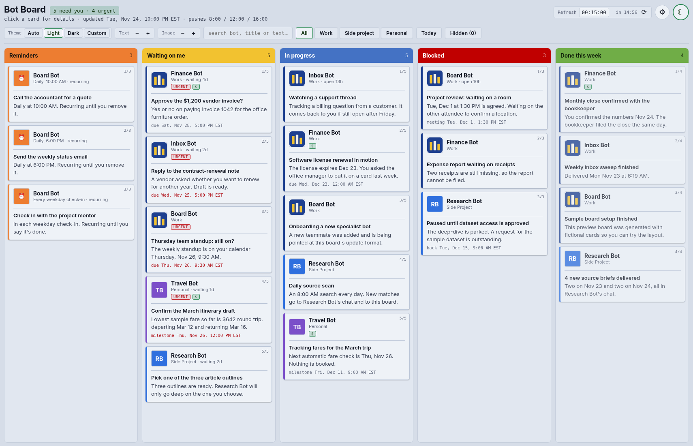

# Bot Board

A visual command board for a multi-bot staff, built around what needs you.

## What it is

Bot Board keeps one screen of what your other bots need from you. The columns, left to right, are:

1. Reminders
2. Waiting on me
3. In progress
4. Blocked
5. Done this week

Each card shows the bot, a short ask, age, a deadline if there is one, a $ badge for money items, and an URGENT flag when something is due within 48 hours or has been waiting more than 3 days (both thresholds are configurable). Opening a card puts **Snooze until tomorrow** (next midnight, by default) first and **Dismiss** last. Hidden restores either one. Search, group filters, a Today filter, text and image sizing, Auto / Light / Dark, a sun/moon toggle, and a 15-minute auto-reload timer are in the top bar. Chat links open the owning bot.

The board itself never sends, pays, or books. Those actions still need a yes in that bot's chat.

## How a new bot gets the board

This repo is the public source for `board.html`. After you add Bot Board, the bot downloads the file from:

https://raw.githubusercontent.com/ejcheramie/bot-board/main/board.html

It then rewrites only the `CONFIG` block at the top with your timezone, groups, colors, and bot list, and delivers the board two ways:

- **A Grok Bot Page first.** Easy to open in the app. A Page is often capped at a fixed centered width and may not fill or shrink with the browser window. That is a platform limit, not a mistake in the board.
- **A standalone HTML file (optional).** This is the version that fills the window and can be bookmarked.

Sample cards in the shipped file are fictional (Inbox Bot, Finance Bot, Research Bot, Travel Bot, Board Bot; groups Work, Personal, and Side Project), so you can try the layout before switching to live items.

## Customize it

The default look matches the original board: gold accent, five columns, comfortable density, urgency of 48 hours / 3 days, snooze until midnight, $ badge on, swimlanes off.

- Use the **gear** in the top bar for visual options (theme, accent, density, fields, title, and more). Those stick in the browser when preference saving is on. Reset to defaults clears them and leaves snoozed or dismissed cards alone.
- Ask the bot to change structural options (column names, order, hidden columns, urgency rules, custom badges, group colors). It edits `CONFIG` only and does not rewrite the UI.
- You can also ask the bot to pull a later UI update from this repo. It will re-download `board.html` and re-apply your CONFIG so your customization is not wiped.

## Optional refresh routines

During setup, the bot can create two optional routines (templates cannot ship routines that do not already exist on the source bot, so the bot creates them with you):

- **Teammate pushes.** Other bots send a short update only when something is new, at times you choose. Default is three times on weekdays (8:00, 12:00, and 16:00 in your timezone). If nothing changed, they send nothing.
- **Board rebuild.** About 15 minutes after each push window, the bot rewrites the CONFIG cards and updates the Page and, if you chose one, the HTML file. It stays quiet unless something urgent lands in Waiting on me, unless you asked for a ping every time.

You can also ask the bot to refresh the board anytime. Job text for both routines lives in `skills/getting-started/SKILL.md`. The files in `routines/` are reference copies of the same instructions.

## What's in this repo

- `board.html` — the board (CONFIG + UI)
- `preview.png` — dark-mode screenshot of the sample board (default look)
- `preview-light.png` — light-mode screenshot with a custom accent
- `skills/getting-started/SKILL.md` — first-run setup, including how to create the optional routines
- `skills/rebuild-board/SKILL.md` — how to refresh cards, or pull a UI update
- `skills/customize-board/SKILL.md` — how the bot applies customization requests
- `routines/teammate-push.md` — reference for the optional teammate update routine
- `routines/rebuild-board.md` — reference for the optional rebuild routine
- `LICENSE` — MIT

## License

MIT. See [LICENSE](LICENSE).
